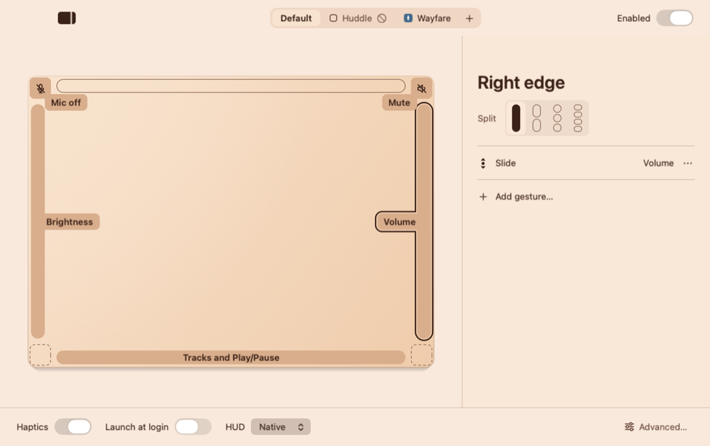
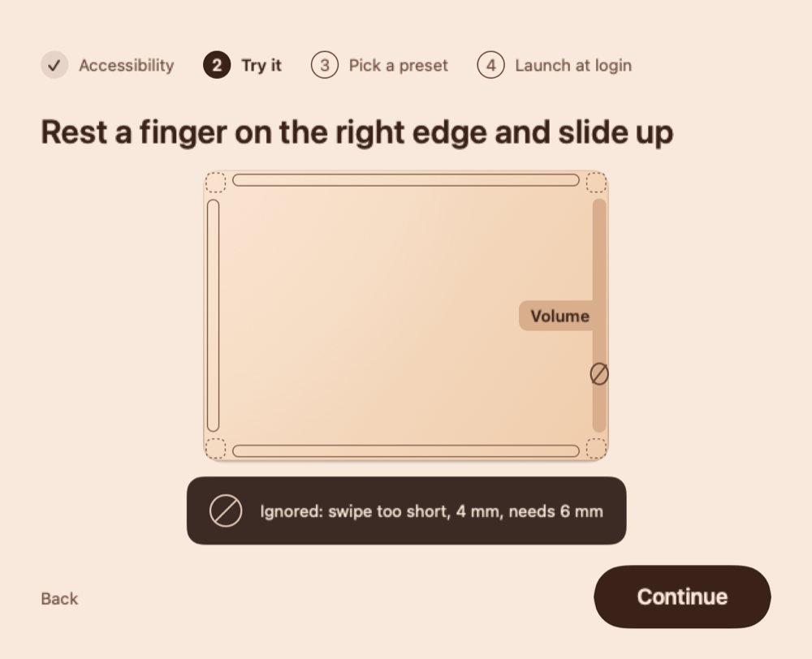
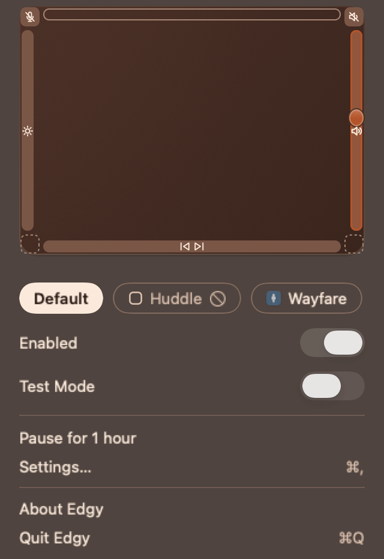

# Edgy

Every edge and corner of your trackpad, mapped to whatever you want.

Edgy is a macOS menu-bar app. Slide a finger up the right edge to change the volume, double-tap a corner to mute the microphone, swipe along the bottom edge to skip a track.

<picture>
  <source media="(prefers-color-scheme: dark)" srcset="docs/readme/settings-dark.png">
  
</picture>

## What it does

- **Any zone, any action.** Four edges and four corners. An edge can be split into up to four parts. Each zone takes a slide, a tap, a double-tap, a swipe along the edge or a long-press, and each gesture runs one action: volume, brightness, keyboard brightness, media keys, mute, Mission Control, Spaces, window halves, opening an app, a URL or a file, a keyboard shortcut, holding keys down while you press, switching apps, or running one of your Shortcuts.
- **Per-app profiles.** Add an app and override only the gestures you want changed there. Everything else follows the default profile, and you can turn Edgy off in one app entirely.
- **No misfires.** A resting palm, a two-finger scroll near the edge, a touch right after you typed, a physical click: each is turned down for a measured reason. Contacts wider than 18 mm are palms. Edge gestures wait 500 ms after a key press. You can change each limit under Advanced… in the settings window.
- **Test Mode.** Turn it on in the menu-bar popover and every touch shows a plate on screen: what ran ("Volume 64%"), or why a touch was ignored ("Ignored: palm, 21 mm wide, limit 18 mm"). Check "Don't run actions" to see what would have run without running it.




### The default layout

| Zone | Gesture | Action |
|---|---|---|
| Right edge | Slide | Volume |
| Left edge | Slide | Brightness |
| Bottom edge | Swipe left | Previous Track |
| Bottom edge | Swipe right | Next Track |
| Bottom edge | Double-tap | Play/Pause |
| Top-right corner | Double-tap | Mute |
| Top-left corner | Double-tap | Microphone Mute |

The first run also offers two other starting points: window moves on the bottom edge, or just volume and brightness.

## Get Edgy

### Download

The signed, notarized build updates itself: [DOWNLOAD_URL](DOWNLOAD_URL). It's the same app with the same features as the one you build yourself.

### Build it yourself

You need macOS 14 or later and a Swift 6.0 or later toolchain (the Xcode command line tools are enough).

```bash
git clone https://github.com/garavitgabriel/edgy.git
cd edgy
make app
```

`make app` builds a release copy at `build/release/Edgy.app`. It signs it with your local Apple Development identity if you have one, and otherwise signs it ad hoc. It doesn't install or launch anything; drag the app into Applications and open it.

The trade-off: a build you make yourself doesn't update itself, so you pull and rebuild for new versions. If it was signed ad hoc, macOS treats each rebuild as a new app, and you'll need to grant Accessibility again (see Troubleshooting).

## First run

Edgy asks for **Accessibility** access. It uses it to keep the pointer still while you slide along an edge and to send the keys most actions need: media keys, volume with the system indicator, shortcuts, held keys, window moves and Spaces. Opening apps, URLs and files works without it. You can skip the step and grant it later; touches still show in Test Mode.

What Edgy reads:
- the positions and sizes of the fingers on your trackpad;
- that a key was pressed and when, so it can ignore the edges while you type, never which key;
- the keys you press while you record a shortcut in Settings, and only then.

Nothing it reads leaves your Mac. Settings live in `~/Library/Application Support/Edgy/config.json`.

## How it works

- **TouchKit** reads raw finger positions from the trackpad, follows trackpads as they come and go, and holds the pointer still during a slide.
- **Gestures** turns touches into gestures and turns down palms, typing, scrolls and stray touches, with the measure and the limit for each. It never touches the system.
- **Actions** and **Displays** run the actions: volume, brightness on built-in and external displays, media keys, windows, shortcuts and haptics.
- **EdgyRuntime** keeps the config, picks the profile for the app in front and routes each gesture to its action.
- **EdgyUI** and **EdgyApp** draw the settings window, the menu-bar popover, the Test Mode plates and onboarding.

## Troubleshooting

**Edgy stopped responding after you rebuilt it.** macOS ties the Accessibility grant to the app's signature, and an ad hoc rebuild has a new one. Open System Settings > Privacy & Security > Accessibility, remove Edgy with the minus button, then add the new build and switch it on.

**A gesture didn't fire.** Turn on Test Mode in the popover and try again. The plate names the reason and the numbers, such as "Ignored: typing, last key 200 ms ago, limit 500 ms". Adjust that limit under Advanced… in the settings window if it doesn't suit how you work.

**You edited config.json and it has an error.** Edgy keeps running your last working settings and names the line with the error. Fix the file and save it; Edgy reloads it on save. The settings window stays read-only until then, so nothing overwrites your edit.

To see what Edgy logged:

```bash
/usr/bin/log show --last 10m --predicate 'subsystem == "com.garavit.edgy"' --info
```

## Contributing

See [CONTRIBUTING.md](CONTRIBUTING.md). To report a security problem, see [SECURITY.md](SECURITY.md).

## Licence

The code is MIT; see [LICENSE](LICENSE). The name "Edgy" and its icon are not covered by the licence: if you ship a build of a fork, give it your own name and icon.
